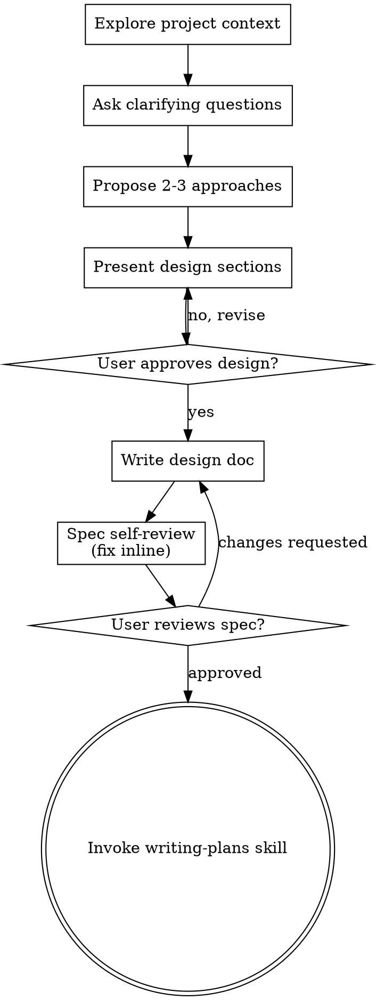

# Brainstorming Ideas Into Designs

Help turn ideas into fully formed designs and specs through natural collaborative dialogue.

Start by understanding the current project context, then ask questions one at a time to refine the idea. Once you understand what you're building, present the design and get user approval.

<HARD-GATE>
Do NOT change production code, scaffold a project, or start implementation until you have presented a design and the user has approved it. This applies regardless of perceived simplicity. When the user explicitly requests a visual preview, use `sketch` for an isolated design experiment; preview authorization does not authorize production integration.
</HARD-GATE>

## Anti-Pattern: "This Is Too Simple To Need A Design"

Every project goes through this process. A todo list, a single-function utility, a config change — all of them. "Simple" projects are where unexamined assumptions cause the most wasted work. The design can be short (a few sentences for truly simple projects), but you MUST present it and get approval.

## Checklist

For production design-to-implementation work, track these items in order. For a requested visual experiment, recover the context and approved scope, produce the bounded preview, then return to design feedback rather than beginning production work:

1. **Explore project context** — check files, docs, recent commits
2. **Choose visual delivery just-in-time** — an explicit request to see a mockup already authorizes a bounded preview. Otherwise, offer a companion only when a question would genuinely be clearer shown. Use the current harness's native visual surface when available; a separate browser/session needs its own applicable approval. See Visual Companion below.
3. **Ask clarifying questions** — one at a time, understand purpose/constraints/success criteria
4. **Compare approaches when choices remain** — give trade-offs and a recommendation; reuse an already approved direction in later preview iterations
5. **Present design** — in sections scaled to their complexity, get user approval after each section
6. **Write design doc** — follow the repository's artifact policy; use the default spec path only when permitted, and commit only when policy and authorization allow
7. **Spec self-review** — quick inline check for placeholders, contradictions, ambiguity, scope (see below)
8. **User reviews written spec** — ask user to review the spec file before proceeding
9. **Transition to implementation** — invoke writing-plans skill to create implementation plan

## Process Flow

**For production implementation, the terminal state is invoking writing-plans.** Do not skip that handoff by invoking an implementation skill directly. For a requested visual experiment, use `sketch`, return its bounded preview for feedback, and keep production code unchanged.

## The Process

**Understanding the idea:**

- Check out the current project state first (files, docs, recent commits).
- For an implementation handoff, recover the canonical brief and any already-approved design before starting questions. Reuse settled goals and architecture; focus required review on unresolved contracts or material design changes rather than restarting the feasibility conversation. Approval to explore a direction is not approval of unreviewed host changes or a different integration route.
- When a design returns from an aside, carry accepted decisions forward and retrieve only missing details from its source discussion. Answer specification-readiness questions with a clear verdict and actual blockers; do not restart a question checklist after the choices are settled.
- Before asking detailed questions, assess scope: if the request describes multiple independent subsystems (e.g., "build a platform with chat, file storage, billing, and analytics"), flag this immediately. Don't spend questions refining details of a project that needs to be decomposed first.
- If the project is too large for a single spec, help the user decompose into sub-projects: what are the independent pieces, how do they relate, what order should they be built? Then brainstorm the first sub-project through the normal design flow. Each sub-project gets its own spec → plan → implementation cycle.
- For appropriately-scoped projects, ask questions one at a time to refine the idea
- Prefer multiple choice questions when possible, but open-ended is fine too
- Only one question per message - if a topic needs more exploration, break it into multiple questions
- Focus on understanding: purpose, constraints, success criteria

**Exploring approaches:**

For feature-feasibility questions in an extensible application, establish the implementation boundary before recommending host changes:

1. Separate the requested experience from its data/control mechanism: metadata display, remote account state, local application control, and embedded playback are different capabilities with different prerequisites.
2. Inspect the application's existing plugin SDK, native-library bridge, permission flow, and shipped examples before placing OS-specific work in core. Distinguish **no host changes**, **no native code**, and **no separate helper process**; a third-party plugin can contain a native component without modifying the host.
3. Compare the smallest viable extension routes: existing SDK alone, plugin plus companion DLL, or plugin plus local helper. Recommend the route that fits the intended distribution and user setup burden; do not assume a JavaScript SDK directly exposes an OS API.
4. State evidence levels separately: a documented hook, a source-traced loading path, and a runtime-tested end-to-end integration are not equivalent. Name the smallest remaining spike, such as permissions/signing, source-context DLL loading, async callbacks, and unload/restart handling, rather than presenting an unexercised route as proven.

Before declaring a native SDK or authoring contract unavailable, inspect the public package inventory, source tree and linked documentation assets, including legacy website repositories and PDFs. Search for author-facing material, not only JS consumer wrappers; extract PDF text with a document reader or `pdftotext -layout` and inspect its links for referenced samples. Pin the source revision when recording findings. Current onboarding can omit a still-public ABI document, so absence from one package or tutorial is only a bounded search result.

Record contract availability, implementation/example availability, licensing, present-host compatibility and distribution support separately. A public document defining exports, calling conventions or COM interfaces can support independently authored bindings without supplying a licensed sample project. Conversely, finding the ABI does not prove allocation ownership, callback threading, unload safety, accepted signing or normal-install loading. Keep those exact gaps open; do not turn them into a blanket missing-SDK claim or silently switch an approved DLL route to a helper process.

Answer the feasibility question at this level first. Treat exploratory discussion as discussion, not authorization to scaffold, write a spec, or implement.

- When material alternatives remain, propose 2-3 approaches with trade-offs; when the user has selected a direction, preview or refine that direction
- Present options conversationally with your recommendation and reasoning
- Lead with your recommended option and explain why

**Presenting the design:**

- Once you believe you understand what you're building, present the design
- Scale each section to its complexity: a few sentences if straightforward, up to 200-300 words if nuanced
- Ask after each section whether it looks right so far
- Cover: architecture, components, data flow, error handling, testing
- Be ready to go back and clarify if something doesn't make sense

**Design for isolation and clarity:**

- Break the system into smaller units that each have one clear purpose, communicate through well-defined interfaces, and can be understood and tested independently
- For each unit, you should be able to answer: what does it do, how do you use it, and what does it depend on?
- Can someone understand what a unit does without reading its internals? Can you change the internals without breaking consumers? If not, the boundaries need work.
- Smaller, well-bounded units are also easier for you to work with - you reason better about code you can hold in context at once, and your edits are more reliable when files are focused. When a file grows large, that's often a signal that it's doing too much.

**Working in existing codebases:**

- Explore the current structure before proposing changes. Follow existing patterns.
- Where existing code has problems that affect the work (e.g., a file that's grown too large, unclear boundaries, tangled responsibilities), include targeted improvements as part of the design - the way a good developer improves code they're working in.
- Don't propose unrelated refactoring. Stay focused on what serves the current goal.

## After the Design

**Documentation:**

- Read the repository's artifact policy before promising a spec path or creating a planning worktree. Save the validated design at its established location; use `docs/superpowers/specs/YYYY-MM-DD-<topic>-design.md` only as a permitted default. If plans/specs must remain outside the checkout, choose an explicit durable external path and report it. User instructions and repository policy override this layout.
- Structure the spec with ATX Markdown headings: one `#` title, `##` sections, and nested `###` subsections. Use emphasis for inline labels within prose, not standalone section headings. Run the repository's Markdown checks and inspect the heading hierarchy before handoff.
- Separate the agreed contract, explicit technical completion defaults, current implementation status and future acceptance requirements. Mark defaults chosen while writing as reviewable proposals, because committing the document does not turn them into prior user approval. When standards documentation describes a broader or newer grammar, preserve the selected authoring profile instead of silently expanding it or claiming the broader syntax cannot exist.
- Parse fenced YAML/JSON examples with the project's actual parsers, enable duplicate-key checks for YAML and resolve relative document links. Run parser probes in the dependency-owning workspace when the root does not expose that parser. Report syntax/document checks separately from runtime qualification: an existing schema can correctly reject a newly specified, unimplemented grammar. Do not loosen production validation merely to make draft examples pass.
- Use elements-of-style:writing-clearly-and-concisely skill if available
- Commit the design document only when repository policy permits tracking it and the applicable authorization covers that commit; otherwise preserve it externally without changing the checkout.

**Spec Self-Review:**
After writing the spec document, look at it with fresh eyes:

1. **Placeholder scan:** Any "TBD", "TODO", incomplete sections, or vague requirements? Fix them.
2. **Internal consistency:** Do any sections contradict each other? Does the architecture match the feature descriptions?
3. **Scope check:** Is this focused enough for a single implementation plan, or does it need decomposition?
4. **Ambiguity check:** Could any requirement be interpreted two different ways? If so, pick one and make it explicit.

Fix any issues inline. No need to re-review — just fix and move on.

**User Review Gate:**
After the spec review loop passes, ask the user to review the written spec before proceeding:

> "Spec saved at `<absolute-path>` [state committed or external-only truthfully]. Please review it before we start the implementation plan."

Wait for the user's response. If they request changes, make them and re-run the spec review loop. Only proceed once the user approves.

**Implementation:**

- Invoke the writing-plans skill to create a detailed implementation plan
- Do NOT invoke any other skill. writing-plans is the next step.

## Key Principles

- **One question at a time** - Don't overwhelm with multiple questions
- **Multiple choice preferred** - Easier to answer than open-ended when possible
- **YAGNI ruthlessly** - Remove unnecessary features from all designs
- **Explore alternatives while the direction is unresolved** - Preserve settled decisions instead of reopening them during a requested preview
- **Incremental validation** - Present design, get approval before moving on
- **Be flexible** - Go back and clarify when something doesn't make sense

## Visual Companion

A browser-based companion for showing mockups, diagrams, and visual options during brainstorming. Available as a tool — not a mode. Accepting the companion means it's available for questions that benefit from visual treatment; it does NOT mean every question goes through the browser.

**Offering the companion (just-in-time):** When the user explicitly asks to see a visual, produce the scoped preview without another offer. For an unsolicited companion, wait until a question would genuinely be clearer shown than told — a real mockup/layout/diagram question, not merely a UI topic — then offer it as its own message:
> "This next part might be easier if I show you — I can put together mockups, diagrams, and comparisons in a browser tab as we go. It's still new and can be token-intensive. Want me to? I'll open it for you."

**When an offer is needed, make it its own message** and wait for the response. After approval, follow the current harness's visual-delivery route. Prefer its native inline preflight/display over starting a helper server. Use the helper-server route only when the separately approved companion needs it and the harness permits it. If the user declines the companion, continue text-only until they raise it again.

**Per-question decision:** Even after the user accepts, decide FOR EACH QUESTION whether to use the browser or the terminal. The test: **would the user understand this better by seeing it than reading it?**

- **Use the browser** for content that IS visual — mockups, wireframes, layout comparisons, architecture diagrams, side-by-side visual designs
- **Use the terminal** for content that is text — requirements questions, conceptual choices, tradeoff lists, A/B/C/D text options, scope decisions

A question about a UI topic is not automatically a visual question. "What does personality mean in this context?" is a conceptual question — use the terminal. "Which wizard layout works better?" is a visual question — use the browser.

For the separately approved helper-server companion route, read its detailed guide before proceeding:
`skills/brainstorming/visual-companion.md`
